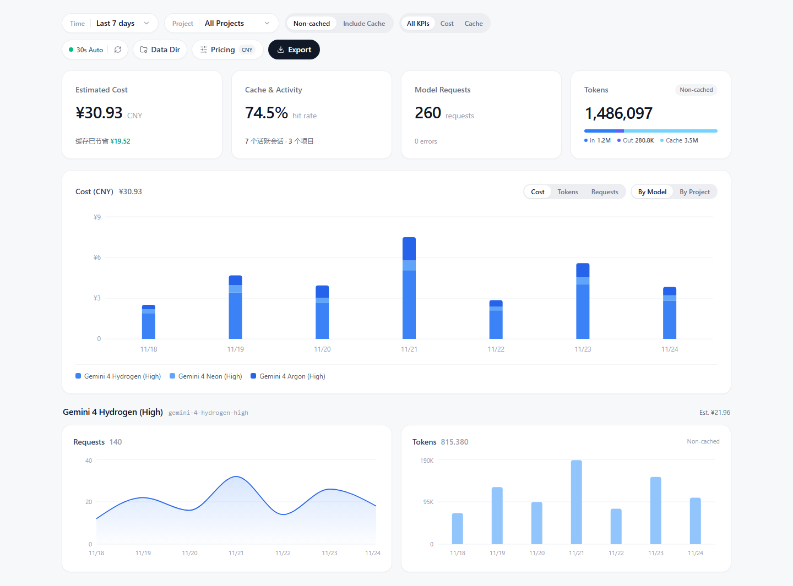

# Antigravity Monitor

**English** | [简体中文](./README.zh-CN.md)

A lightweight, **100% local & privacy-first** usage dashboard for **Google Antigravity**.  
Track your historical token consumption, cache hit rate, model request trends, per-model breakdowns, and estimated API cost — with zero cloud backend and zero setup friction.



---

## ✨ Features

- **100% Local & Read-Only**: Reads directly from your local `~/.gemini/antigravity` directory. No data ever leaves your machine, and no Antigravity files are ever modified.
- **Flexible Token Counting**: Shows **Non-cached Tokens (`Input + Output`)** by default, with a one-click toggle to **Include Cache (`+ Cache Read`)** synced across KPIs, charts, and exports.
- **Cost & Cache Efficiency KPIs**: Displays estimated API cost (with cache savings), cache hit rate & active sessions, total model requests, and token breakdown — with switchable KPI view modes (`All KPIs` / `Cost` / `Cache`).
- **Interactive Visualizations**:
  - Stacked bar trend chart (hourly for `Today`, daily for multi-day ranges) supporting `Cost` / `Tokens` / `Requests` and `By Model` / `By Project` grouping.
  - Per-model dual cards: smooth area chart for requests + bar chart for tokens.
  - Top sessions table ranked by token consumption.
- **Custom Model Pricing & Currency**: Configure per-model USD/1M token rates and USD↔CNY exchange rate directly in the UI (saved locally to `data/pricing.json`).
- **One-Click Export**: Export the currently filtered view to **CSV** (with UTF-8 BOM for Excel) or **JSON**.
- **Cross-Platform & Custom Directory Support**: Automatically detects your Antigravity directory on Windows, macOS, and Linux, plus supports custom directories via UI or environment variable.

---

## 🚀 Quick Start (3 Steps)

### Prerequisites

- **Node.js 20+** (Recommended: **Node.js 22.5+ / 24+** to enable built-in `node:sqlite` for automatic project names and session titles. On Node 20, the dashboard still works gracefully for all token/model charts!)

### Install & Run

```bash
# 1. Clone the repository
git clone https://github.com/<your-username>/antigravity-monitor.git
cd antigravity-monitor

# 2. Install dependencies
npm install

# 3. Start the local dashboard
npm run dev
```

Open the URL printed in your terminal (usually `http://localhost:5173`) in your browser — your local Antigravity usage will load automatically!

> **Production preview**: You can also run `npm run build && npm run preview` to serve the production bundle on a single port.

---

## 📂 Customizing the Antigravity Data Directory

By default, Antigravity Monitor automatically locates your Antigravity data folder using your OS home directory:

- **Windows**: `C:\Users\<YourName>\.gemini\antigravity`
- **macOS**: `/Users/<YourName>/.gemini/antigravity`
- **Linux**: `/home/<YourName>/.gemini/antigravity`

If your Antigravity files are stored elsewhere (e.g., custom profile, backup folder, or running inside WSL while reading Windows logs), the app resolves the directory in this exact priority order:

1. **In-App UI Setting (Recommended for beginners)**  
   Click the **`Data Dir`** button in the top bar (or the prompt button when no logs are found), enter your folder path, and click **Save & Rescan**. The setting is stored locally in `data/config.json` (git-ignored).
2. **Environment Variable (`ANTIGRAVITY_DATA_DIR`)**  
   Great for CLI/WSL users:
   ```bash
   # macOS / Linux / WSL
   ANTIGRAVITY_DATA_DIR="/mnt/c/Users/YourName/.gemini/antigravity" npm run dev
   ```
   ```powershell
   # Windows PowerShell
   $env:ANTIGRAVITY_DATA_DIR="D:\backup\antigravity"; npm run dev
   ```
   *(You can also put `ANTIGRAVITY_DATA_DIR=...` inside a `.env.local` file in the project root.)*
3. **Automatic OS Default** (`~/.gemini/antigravity`)

---

## 🔒 Privacy & Data Scope

- **No network requests**: The app only serves local API endpoints (`/api/usage`, `/api/pricing`, `/api/config`) inside Vite's local Node.js process.
- **Strictly read-only**: Your `~/.gemini/antigravity` files (`brain/*/.system_generated/logs/transcript.jsonl` and `conversation_summaries.db`) are opened in read-only mode only.
- **No prompt/code content retained**: Only step timestamps, model IDs, token counts, tool call counts, and session titles/project names are parsed into memory.
- **Local configs git-ignored**: Your `data/` folder (`pricing.json` and `config.json`) is listed in `.gitignore` so personal paths or custom prices are never accidentally committed.

---

## ❓ FAQ

**Q: Why does the footer mention "legacy `.pb` sessions not counted"?**  
Older versions of Antigravity stored conversations exclusively in binary `.pb` files without generating plain-text `transcript.jsonl` logs. Antigravity Monitor only parses sessions that contain `transcript.jsonl` and transparently reports the count of legacy `.pb` files in the footer.

**Q: Are the cost numbers my actual Google billing amount?**  
No. Antigravity uses plan/quota-based limits rather than per-token API billing, so local logs do not contain real invoice amounts. The **Estimated Cost** card calculates the equivalent API value based on customizable per-million-token rates in the **`Pricing`** modal.

**Q: Does this read logs from other tools like Claude Code or Codex?**  
No. It is focused exclusively on Google Antigravity (`~/.gemini/antigravity`).

---

## 🛠️ Tech Stack & Scripts

- **Frontend**: React 19, TypeScript, Vite, Tailwind CSS v4, Recharts, Lucide Icons
- **Local Server Layer**: Vite Server Middleware (`configureServer` & `configurePreviewServer`), Node.js native `node:sqlite` (with graceful fallback)
- **Tests**: Vitest

```bash
npm run dev        # Start local dev server + API on a single port
npm run build      # Typecheck and build production assets
npm run preview    # Preview production build with local API
npm run typecheck  # Run TypeScript check (tsc --noEmit)
npm test           # Run unit tests (Vitest)
```

## 📄 License

[MIT](./LICENSE)
