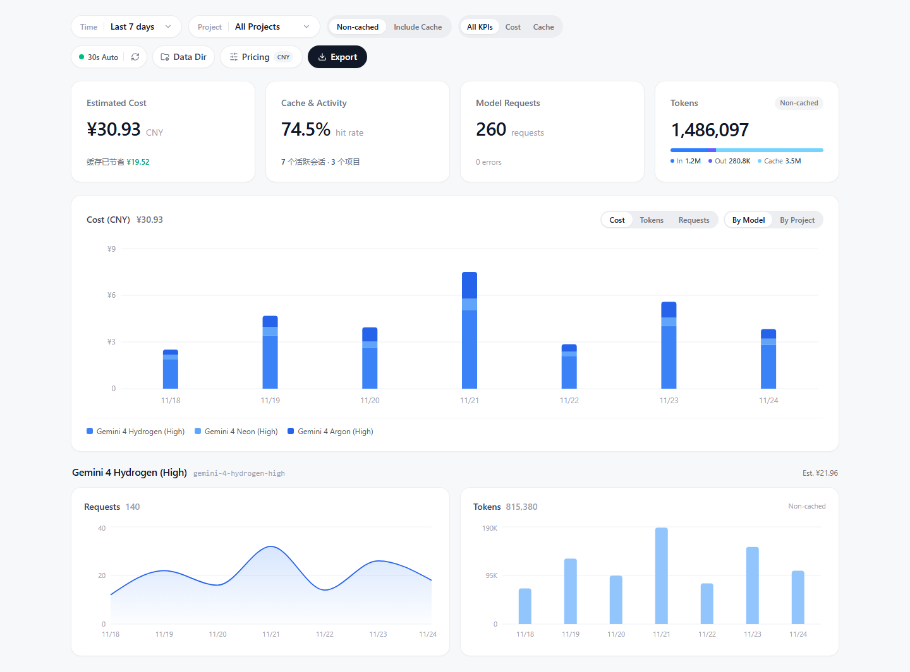

# Antigravity Monitor

[English](./README.md) | **简体中文**

一个轻量、**100% 本地只读、隐私优先**的 **Google Antigravity** 用量监控仪表盘。  
帮你直观查看历史 Token 消耗、缓存命中率、模型调用趋势、各模型独立图表与等效 API 估算费用——单端口启动，零云端依赖，开箱即用。



---

## ✨ 核心特性

- **100% 本地只读，保护隐私**：直接读取你电脑上的 `~/.gemini/antigravity` 日志目录，不联网、不上传任何数据，也绝不修改 Antigravity 原始文件。
- **灵活的 Token 统计口径**：默认展示 **非缓存 Token（`Input + Output`）**，顶部一键切换 **含缓存读取（`+ Cache Read`）**，实时联动 KPI 卡片、所有图表与数据导出。
- **费用估算与缓存效率双视角**：同时展示估算等效费用（附带“缓存已节省金额”）、缓存命中率与活跃会话数、模型请求次数及 Token 分布比例条，并支持在 `All KPIs` / `Cost` / `Cache` 视图间一键切换。
- **高颜值交互式图表**：
  - 主趋势堆叠柱状图（选 `Today` 自动按小时聚合，多日范围按天聚合），支持切换 `Cost` / `Tokens` / `Requests` 指标与 `By Model` / `By Project` 分组，附带悬浮明细 Tooltip。
  - 按模型拆分的双栏详情卡片：左栏 Requests 平滑面积折线图，右栏 Tokens 柱状图。
  - 高消耗会话排行表（Top Sessions），一眼定位最耗 Token 的项目与对话。
- **自定义单价与汇率**：点击右上角 **`Pricing`** 即可随时修改各模型每百万 Token 单价并切换 `CNY` / `USD`（保存在本地 `data/pricing.json`）。
- **一键导出明细**：支持将当前筛选条件与统计口径下的数据导出为 **CSV**（带 UTF-8 BOM，Excel 打开不乱码）或 **JSON**。
- **跨平台自动识别 + 自定义目录**：Windows / macOS / Linux 开箱自动定位目录，也支持通过界面或环境变量指定任意路径。

---

## 🚀 新手 3 步快速上手

### 环境准备

- **Node.js 20 及以上**（**推荐使用 Node.js 22.5+ / 24+**，可启用 Node 原生内置 `node:sqlite` 自动关联项目名称与对话标题；如果使用 Node 20，所有 Token 与模型统计依然可优雅降级正常运行）

### 安装与启动

```bash
# 1. 克隆仓库到本地
git clone https://github.com/<你的用户名>/antigravity-monitor.git
cd antigravity-monitor

# 2. 安装依赖
npm install

# 3. 启动本地监控面板
npm run dev
```

启动后，用浏览器打开终端里输出的地址（通常是 `http://localhost:5173`），就会自动扫描并展示你本机的 Antigravity 历史用量！

> **生产构建运行**：也可以执行 `npm run build && npm run preview` 以单端口生产预览模式运行。

---

## 📂 不同电脑 / 自定义存储目录怎么配置？

默认情况下，程序会根据操作系统自动读取你当前账号下的 Antigravity 目录，**大多数用户无需做任何配置**：

- **Windows**：`C:\Users\<你的用户名>\.gemini\antigravity`
- **macOS**：`/Users/<你的用户名>/.gemini/antigravity`
- **Linux**：`/home/<你的用户名>/.gemini/antigravity`

如果你的 Antigravity 数据存放在其他位置（例如修改了目录、查看备份文件夹，或在 WSL 中读取 Windows 宿主目录），支持按以下 **3 级优先级** 覆盖：

1. **方式一：直接在页面配置（最推荐，对新手最友好）**  
   点击顶部栏的 **`Data Dir`** 按钮（如果默认目录为空，页面中央也会直接弹出引导按钮），填入你的目录路径后点击 **“保存并重新扫描”** 即可。配置仅保存在本地 `data/config.json`（已被 `.gitignore` 忽略）。
2. **方式二：环境变量 `ANTIGRAVITY_DATA_DIR`（适合命令行 / WSL 用户）**
   ```powershell
   # Windows PowerShell
   $env:ANTIGRAVITY_DATA_DIR="D:\backup\antigravity"; npm run dev
   ```
   ```bash
   # macOS / Linux / WSL
   ANTIGRAVITY_DATA_DIR="/mnt/c/Users/YourName/.gemini/antigravity" npm run dev
   ```
   *(也可以在项目根目录新建 `.env.local` 文件并写入 `ANTIGRAVITY_DATA_DIR=你的路径`)*
3. **方式三：自动默认路径**（`~/.gemini/antigravity`）

---

## 🔒 数据来源与隐私说明

- **单工程单端口、纯本地运行**：没有云端后端，仅通过 Vite 本地 Node.js 中间件挂载 `/api/usage`、`/api/pricing`、`/api/config`。
- **严格只读**：仅以只读方式解析 `~/.gemini/antigravity/brain/*/.system_generated/logs/transcript.jsonl` 和 `conversation_summaries.db`，绝不写入或破坏原始数据。
- **不留存对话正文与代码**：解析时仅提取时间戳、模型 ID、Token 计数、工具调用数、会话标题与项目名，自动丢弃对话正文与思考过程。
- **防隐私误提交**：`data/` 目录已在 `.gitignore` 中排除，你的自定义路径和单价配置不会被提交到 Git 仓库。

---

## ❓ 常见问题（FAQ）

**Q：页脚提示“X 个早期旧格式 (.pb) 会话未计入”是什么意思？**  
Antigravity 早期版本的会话仅以二进制 `.pb` 格式保存，不包含明文 `transcript.jsonl` 日志。本工具只统计包含 `transcript.jsonl` 的新版会话，并在页脚透明展示未计入的旧格式会话数量。

**Q：页面上的“估算费用（Estimated Cost）”是真实扣费账单吗？**  
不是。Antigravity 本身采用配额/订阅制而非按 Token 计费，本地日志中不含账单金额。费用卡片是根据 **`Pricing`** 弹窗里的各模型每百万 Token 单价换算出的**等效 API 价值**，你可以随时按需修改单价或切换到 `Cache` 卡片视图。

**Q：会读取 Claude Code 或其他 AI 编程工具的记录吗？**  
不会。本项目专注且仅读取 Google Antigravity（`~/.gemini/antigravity`）的数据。

---

## 🛠️ 技术栈与常用命令

- **前端**：React 19、TypeScript、Vite、Tailwind CSS v4、Recharts、Lucide Icons
- **本地数据层**：Vite 中间件插件（`configureServer` / `configurePreviewServer`）、Node.js 原生 `node:sqlite`（支持低版本优雅降级）
- **测试**：Vitest

```bash
npm run dev        # 启动本地开发服务与只读 API（单端口）
npm run build      # 执行类型检查并打包生产产物
npm run preview    # 预览生产构建产物（同样包含本地 API）
npm run typecheck  # 仅运行 TypeScript 类型检查
npm test           # 运行全部单元测试
```

## 📄 开源协议

本项目基于 [MIT License](./LICENSE) 开源。
